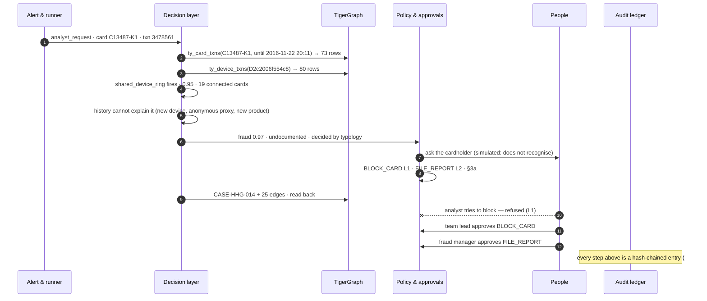
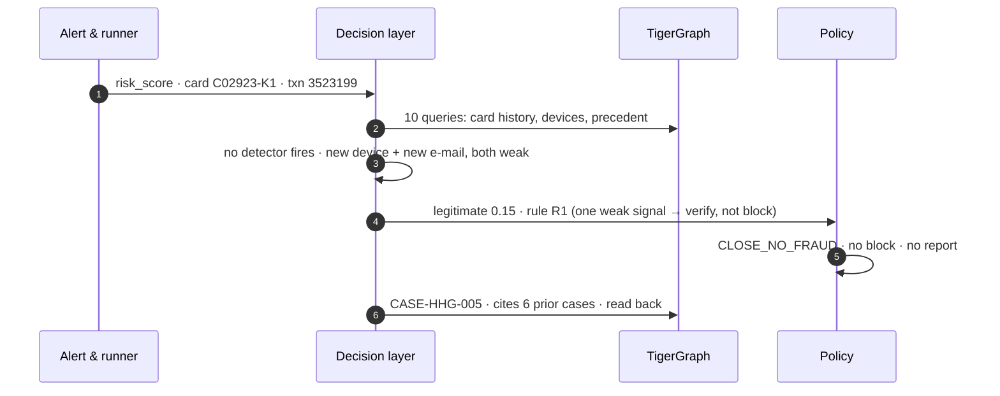
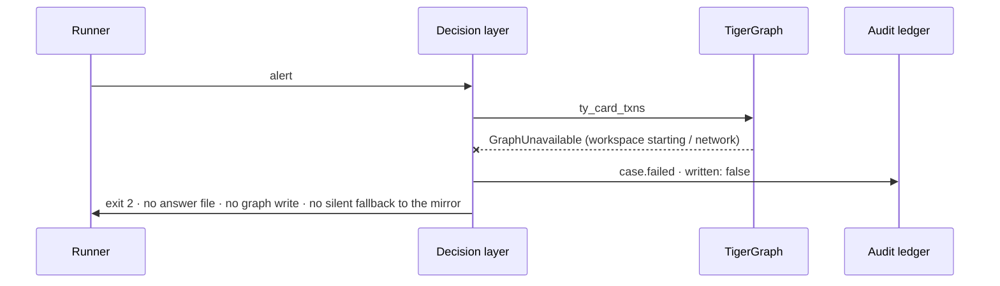
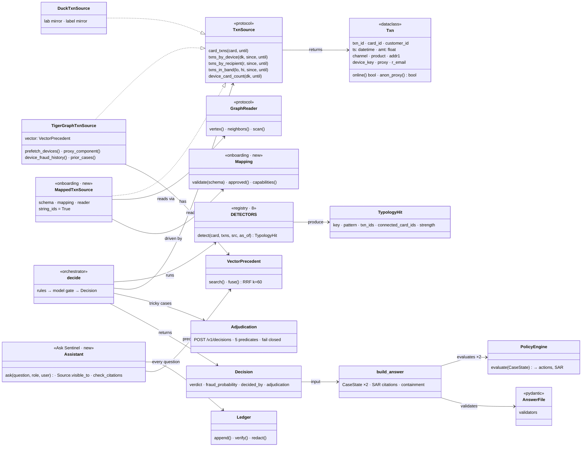
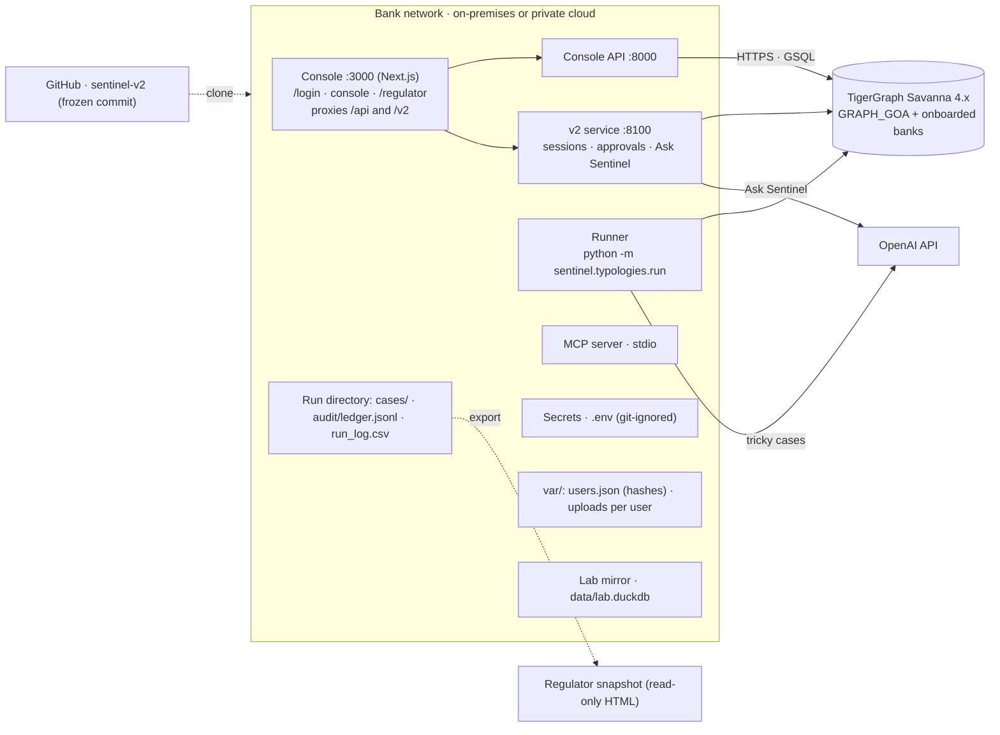

# Sentinel — technical design (HLD and LLD)

**An agent that investigates card fraud on a graph, and knows when not to block.** Sentinel reads a bank's
transaction graph, finds fraud patterns nobody wrote down, refuses to harm a customer on a single odd signal, asks a
person before it blocks anything, and writes every step into a tamper-evident record a regulator can check. New this
round: **Ask Sentinel**, an assistant that answers anyone's question from only what their role may see and cites every
claim, and **bank onboarding**, which brings any bank's graph schema to the same detectors through one reviewed,
signed mapping.

Interactive version (click-through system map, six walkthroughs with their real log entries, a live hash-chain
tamper demo): [claude.ai/artifact/Em7gXScLV88xp8QYwcu9aL](https://claude.ai/artifact/Em7gXScLV88xp8QYwcu9aL).
One-page view: [SYSTEM_ON_ONE_PAGE.md](SYSTEM_ON_ONE_PAGE.md).

| | | source |
|---|---|---|
| **6 → 16 / 20** | Round 1 cases correct, live on the graph | `eval/out/regulator_demo` |
| **4 → 0** | innocent customers blocked | same 20 cases |
| **2.0%** | innocent alerts called fraud, on data it never saw | `eval/overfit_check.py`, n = 300 |
| **36** | GSQL queries installed in TigerGraph | `graph/queries/*.gsql` |
| **894** | audit entries, hash-chained, chain intact | `audit/ledger.jsonl` |
| **0** | sources outside the role sent to the assistant model | `tests/unit/test_assistant.py` |
| **3** | bank schemas onboarded, same detectors (ISO 20022, BIAN, T24) | `onboarding/banks/` |

**Pipeline:** alert → validate → read the graph → 8 detectors → history checks → rules, then model if needed →
policy engine → human approval → graph write-back → audit chain · Ask Sentinel over all of it.

---

## 1. High-level design

The system map is in [SYSTEM_ON_ONE_PAGE.md](SYSTEM_ON_ONE_PAGE.md). Four layers, one boundary: everything inside
runs on the bank's side; TigerGraph and the model provider sit outside it, and every arrow that crosses the line
carries pseudonymous ids only.

| Component | What it does | Where it lives | Proof |
|---|---|---|---|
| Sign-in & roles | Username + password (salted PBKDF2, lock-out after 5 failures) → one HttpOnly, SameSite=Strict session signed by the server; the console API and the v2 service both read it. Signed-out visitors go to `/login`; regulators land on their overview | `frontend/src/middleware.ts`, `api/auth.py`, `api_v2/users.py` | No session, or a forged role header: 401 on every `/api` call |
| Console :3000 | Queue, case timeline with the probability trajectory, the case's graph, memory, SAR, approvals. Proxies `/api` → :8000 and `/v2` → :8100 | `frontend/`, `next.config.ts` | HHG-014's graph read live: 25 nodes, 24 edges |
| Regulator view | Every investigation, examiner walkthrough, approval chain, change record, in-browser hash recomputation | `api_v2/static/regulator.html` | Exportable as a read-only file |
| MCP tools | card_history, device_history, ring_components, investigate_alert, verify_audit. No raw GSQL, no writes | `api_v2/mcp_server.py` | Every call is an audit entry |
| Runner · run.sh | One command per case or pack; `run.sh` starts the three services, warms the graph, runs and grades | `run.sh`, `sentinel/typologies/run.py` | Exit 2 if the graph is down; nothing written |
| **Ask Sentinel** | Plain-language Q&A over investigations, audit trails, the live graph, closed-case vectors, the change record, project docs and the person's own uploads; every claim cited | `api_v2/assistant.py`, `AskSentinel.tsx` | Analyst asking for the access log: "not found", needs `audit.all` |
| Validate alert | Fields, timestamp, trigger type, ids; refuses with the reason | `run.py · validate_alert()` | 5 malformed alerts: 5 refused |
| Batched graph read | Every device the card used in 35 days, in one GSQL call | `ty_devices_batch` | 373 queries → 15; 170 s → 17 s |
| 8 detectors + rings | Structuring, device ring, ring device returning, dormant wake, escalation, micro-charges, recipient concentration, card testing; rings by label propagation in TigerGraph | `typologies/detectors.py` | Round 1's two hidden patterns caught |
| History checks | Six look-alike tests from the bank's cleared-case notes | `explain.py`, `anomalies.py` | Stopped 4 innocent blocks |
| Rules | Typology → R2 (customer denial) → explained → R1 (one weak signal) → R7; only the rest goes to the model | `typologies/decide.py` | Each rule switchable for ablation |
| Model gate | Five probabilities, never prose; may not block a single charge alone; failure → uncertain + escalate | `adjudicator.py` | Defended: 0 of 36 injections flipped a verdict |
| Policy engine | R1–R10, §3a report rule, routes auto / L1 / L2; runs before and after the evidence request | `sentinel/policy/engine.py` | No model in this path |
| Containment | Block cards whose exposure outweighs disruption; monitor the rest | `containment.py` | Micro ring: +$84 vs −$2,386 blocking all |
| Approval chain | L1 by team lead, L2 by fraud manager; refusals recorded | `approvals.py` | Analyst → L1 refused; team lead → L2 refused |
| Write-back & read-back | FraudCase + edges, marked saved only after reading back | `writeback.py` | 20 / 20 read back |
| Audit ledger | Append-only, each entry carries the SHA-256 of the one before | `typologies/audit.py` | Editing an entry breaks the chain there |
| TigerGraph Savanna 4.x | GRAPH_GOA (650,938 transactions, 5,585 closed cases with vectors) plus each onboarded bank's own graph; tokens from `/gsql/v1/tokens` | `graph/`, `sentinel/graph/token.py` | Outside the boundary: pseudonymous ids only |
| OpenAI API | Decisions (5 probabilities), embeddings (precedent, Ask Sentinel retrieval), Ask Sentinel's cited answers | `adjudicator.py`, `vector.py`, `assistant.py` | Withheld sources never leave |
| **Bank onboarding** | Any bank schema → canonical model: propose, validate, review, approve; one generic adapter; capabilities | `sentinel/onboarding/`, [ONBOARDING.md](../ONBOARDING.md) | 3 banks, 79 / 79 after review, 0 wrong |

---

## 2. Data flow: six walkthroughs

### 2.1 Device ring → fraud, report filed, two approvals (HHG-014)



### 2.2 Innocent look-alike → legitimate, never blocked (HHG-005)



### 2.3 Tricky case → model asked → uncertain, escalated (HHG-015)

```mermaid
sequenceDiagram
  autonumber
  participant D as Decision layer
  participant G as TigerGraph
  participant M as OpenAI decisions
  participant P as Policy
  D->>G: 14 queries + closed-case vectors
  D->>D: amount explained by product + e-mail; device and region not
  D->>M: evidence bundle, alert text quoted as untrusted
  M-->>D: is_fraud 0.81 · history 0.05 · coordinated 0.12
  D->>P: uncertain 0.69 (a single charge cannot be blocked on the model alone)
  P->>P: ESCALATE_TO_ANALYST · MONITOR_CARD · no block
```

### 2.4 Graph unavailable → fail closed



### 2.5 Ask Sentinel: a question the role may not fully see

```mermaid
sequenceDiagram
  autonumber
  participant U as Analyst (raj)
  participant A as Ask Sentinel
  participant G as TigerGraph + stores
  participant M as OpenAI
  participant L as Audit ledger
  U->>A: "Who failed to sign in, according to the access log?"
  A->>A: build 114 sources · drop 4 the analyst may not see (audit.all) BEFORE ranking
  A->>G: retrieve: ids + keywords + embeddings + closed-case vectors, fused by RRF (k = 60)
  A->>A: scan question and sources for instruction-like text → passed as quoted data
  A->>M: only the allowed sources, quoted; withheld permission named
  M-->>A: answer with [S1]-style citations
  A->>A: remove citations to sources not given; uncited → "unverified"; mask PII
  A->>U: "not found in what you can see · your role lacks audit.all" + source links
  A->>L: question (redacted), sources used, permissions that withheld others
```

### 2.6 Onboarding a new bank (Temenos T24)

```mermaid
sequenceDiagram
  autonumber
  participant B as Bank schema (.gsql)
  participant O as Onboarding
  participant M as OpenAI
  participant R as Reviewer
  participant T as Team lead
  participant G as Bank's TigerGraph graph
  participant D as Same detectors
  B->>O: 11 vertex types, 18 edges, T24 names
  O->>M: schema STRUCTURE only (never its comments) + canonical model
  M-->>O: proposed mapping
  O->>O: validate every vertex / attribute / edge / path; send problems back (≤ 2 repairs)
  O->>R: needs review: code tables, filter values
  R->>O: 8 changes with reasons (DATE_TIME is YYMMDDHHMM; OT/AC online; SIGN.ON)
  T->>O: signed approval bound to the mapping's SHA-256
  O->>O: capabilities: 7 of 10 detectors (no transfer→terminal link)
  D->>G: generic adapter, built-in REST endpoints only
  G-->>D: 21 real transactions (no ledger postings)
  D->>D: structuring fires · FT26000102–104 · 2 sibling accounts
```

---

## 3. Low-level design: classes



---

## 4. Deployment



| Mode | How it starts | Reads from | Writes | Used for |
|---|---|---|---|---|
| Whole app | `./run.sh start` → localhost:3000 | graph, run directory, answers | approvals, sign-ins, refusals, assistant questions into the chain | analysts, team leads, fraud managers, regulators |
| Live | `python -m sentinel.typologies.run --pack … --out cases` | GRAPH_GOA | answer files, FraudCase write-back, audit chain | the case pack, drills, the demo |
| Lab mirror | `--source lab` | `data/lab.duckdb` | answers labelled "mirror" | backtests, overfitting checks, parity (20 / 20) |
| Rules only | `--no-model` | graph or mirror | tricky cases become uncertain + escalate | drills, ablation |
| Onboard a bank | `./run.sh onboard propose \| build \| approve \| dryrun` | the bank's GSQL schema, then its graph | proposed / reviewed / approved mapping, capability report | bringing a new bank to the same detectors |
| Investigate in a bank | `run --bank Bank_CoreT24 --pack …` | the bank's graph via its approved mapping | answer files, audit chain (no write-back: no Sentinel case vertex) | alerts at an onboarded bank |
| Regulator snapshot | `scripts/export_regulator_snapshot.py` | one self-contained HTML file | nothing | an examiner who should not reach the bank's systems |

---

## 5. Pillars of excellence

| Pillar | How | Proof | Change it in |
|---|---|---|---|
| **Auditable** | Every query, detector, model score, decision, approval, refusal, sign-in, failure and assistant question is a ledger entry; each carries the hash of the one before | 894 entries, chain intact; editing one breaks it there | `typologies/audit.py` |
| **Safe by default** | Graph down → stop, record, write nothing. Model fails → uncertain + escalate. One weak signal → verify, never block. No block on a single charge from the model alone | Innocent blocks 4 → 0; 5 / 5 malformed alerts refused | `decide.py`, `run.py` |
| **Secure, least privilege** | Salted PBKDF2, lock-out; role from a server-signed session; one permission table; the model has no query or write access; PII masked in logs | 24 sign-in and permission tests; forged role header ignored | `api_v2/rbac.py`, `users.py` |
| **Explainable** | Every verdict names the rule or detector; every SAR sentence cites its transactions or policy; examiner walkthrough | 0 hard, 0 policy findings on 20 answers | `offline.py`, `regulator.html` |
| **Measured, not assumed** | Rules judged on data they were never tuned on; each rule switchable; graph and mirror must agree | 2.0% held-out false positives · 299 / 300 frauds kept · 20 / 20 parity | `eval/overfit_check.py` |
| **Scalable** | Rings by label propagation inside TigerGraph; one batched read per case; stateless services, independent cases | Largest card 373 → 15 queries, 170 → 17 s | `sentinel_queries_v3.gsql` |
| **Ask Sentinel: safe to ask** | Entitlement before ranking; untrusted text as quoted data; every claim cited, invalid citations removed | 0 withheld sources sent to the model; 8 tests | `api_v2/assistant.py` |
| **Adaptable to any bank** | One canonical model; a bank is a reviewed, signed mapping, not new code; every name and path checked; unfed detectors switched off with the reason | ISO 20022, BIAN, T24: 79 / 79 after review, 0 wrong; same fraud found live in all three | `sentinel/onboarding/` |
| **Easy to change** | A new pattern is one function in a registry; who may do what is one table; data and schema changes wait for a signed approval | One script runs it all: `./run.sh start · warmup · pack · test · onboard` | `detectors.py`, `rbac.py`, `run.sh` |

---

## 6. Logs and audit

Every entry stores the SHA-256 of the entry before it; change who approved a report and the chain breaks at exactly
that entry (try it in the interactive version).

```
seq 711  approval.requested  BLOCK_CARD (L1)  approvers team_lead or fraud_manager
seq 712  approval.requested  FILE_REPORT (L2) approvers fraud_manager
seq 866  approval.denied     BLOCK_CARD refused for demo.analyst.raj: role analyst may not approve L1
seq 867  approval.granted    BLOCK_CARD (L1) approved by demo.lead.priya (team_lead)
seq 869  approval.granted    FILE_REPORT (L2) approved by demo.manager.anika (fraud_manager)
seq 870  status.changed      → actions_approved
```

Per-case run log (`run_log.csv`):

```
case_id   latency_s graph_queries model_tokens decided_by           verdict
HHG-005   4.98      10            0            rule_R1_weak_single  legitimate
HHG-014   1.14      3             0            typology             fraud
HHG-015   7.33      14            5373         model                uncertain
ISO-001   81.1      66            0            typology             fraud        (onboarded ISO 20022 bank, live)
BIAN-001  178.6     395           0            typology             fraud        (onboarded BIAN bank, live)
T24-001   86.1      170           0            typology             fraud        (onboarded T24 bank, live)
```

Access log and refusals share the chain (case `_access`); Ask Sentinel's questions are case `_assistant`; a failure
is recorded instead of guessed:

```
{"kind":"login.failed","actor":"lead.priya","data":{"why":"wrong password"}}
{"kind":"access.refused","actor":"examiner.ines","data":{"permission":"approve.L1"}}
{"case_id":"BAD-005","kind":"case.failed","data":{"error":"UnknownId: … C99999-K9 does not exist in the graph","written":false}}
```

---

## 7. Where to read more

| | |
|---|---|
| Running it | [ROUND2_RUN.md](../ROUND2_RUN.md), `./run.sh help` |
| Onboarding a bank | [ONBOARDING.md](../ONBOARDING.md) |
| Resilience | [RESILIENCE.md](../RESILIENCE.md) |
| The innovation claim | [INNOVATION.md](../INNOVATION.md) |
| Requirement checklist | [ROUND2_CHECKLIST.md](../ROUND2_CHECKLIST.md) |
