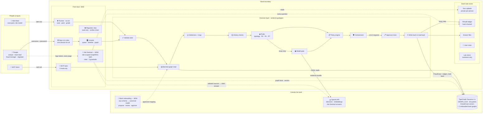

# Sentinel — the system on one page

> Facts come from TigerGraph, belief from detectors and history checks, decisions from rules and a policy engine.
> The model only scores what the rules cannot settle, a person approves every block and report, **Ask Sentinel**
> answers anyone's questions from only what their role may see, with sources, and new banks plug in through
> **bank onboarding**: any schema, the same detectors.

Interactive version (click any box for what it does and where it lives):
[claude.ai/artifact/JYEWEZyCDC1yXwjtYhPzCC](https://claude.ai/artifact/JYEWEZyCDC1yXwjtYhPzCC) ·
full design: [ARCHITECTURE.md](ARCHITECTURE.md)

| Layer | What it holds |
|---|---|
| **People & inputs** | four roles; an MCP-speaking assistant; the alert feed |
| **Front door :3000** | one sign-in and session for every service; the console; the regulator view; read-only MCP tools; the runner; Ask Sentinel |
| **Decision layer** | validate → one batched graph read → 8 detectors → history checks → rules → model (tricky cases only) → policy engine → containment → human approval → write-back with read-back |
| **Bank-side stores** | private uploads, the hash-chained audit ledger, answer files, salted user store, the lab mirror (backtests only, never a silent fallback) |
| **Outside the bank** | TigerGraph (the source of truth, plus each onboarded bank's own graph), OpenAI (pseudonymous ids only), bank onboarding |

**The numbers:** 6 → 16/20 Round 1 cases correct live · 4 → 0 innocent customers blocked · 2.0% held-out false
positives · 894 hash-chained audit entries · 3 assistant guardrails, 0 withheld sources sent to the model ·
3 bank schemas onboarded (ISO 20022, BIAN, T24) with the same detectors.
